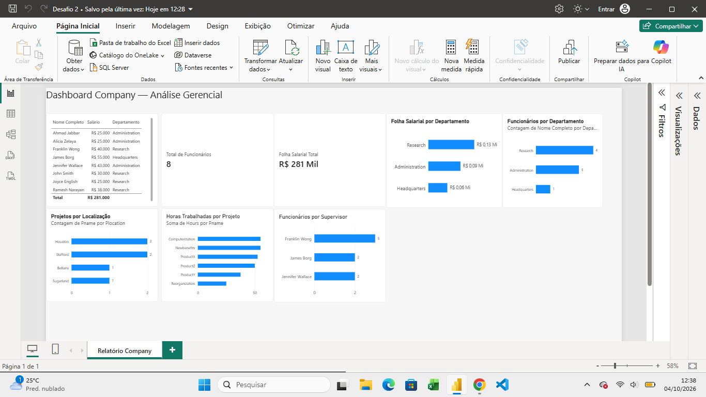
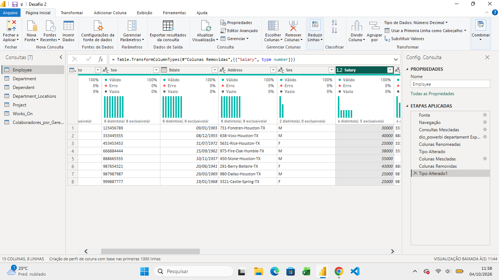
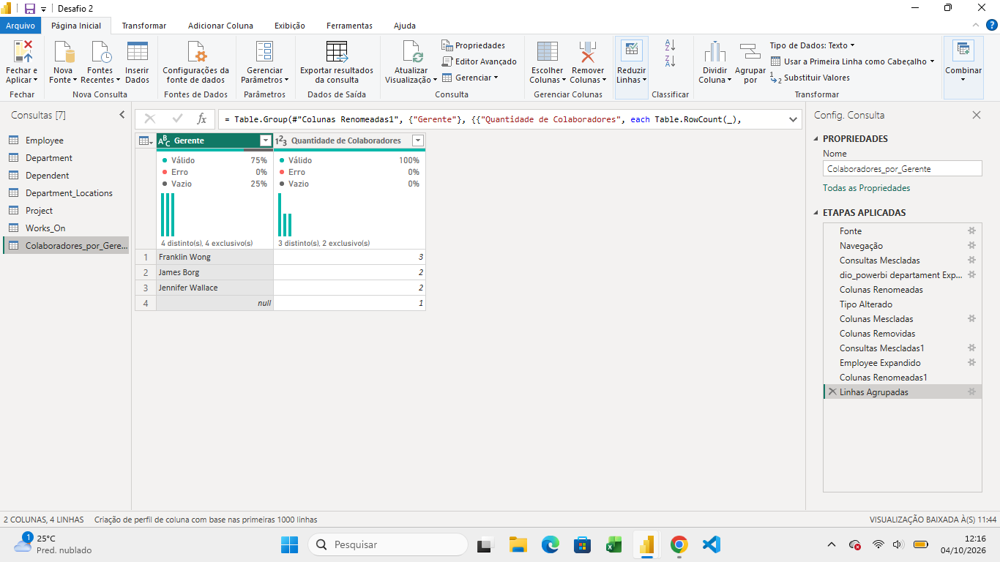
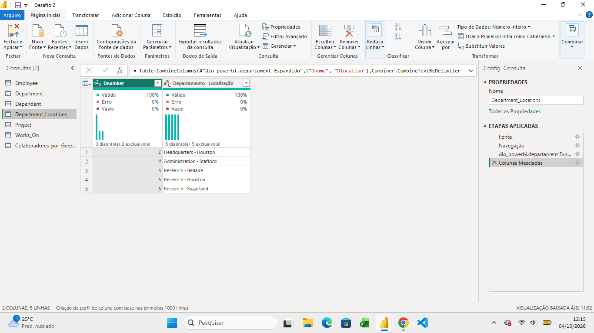
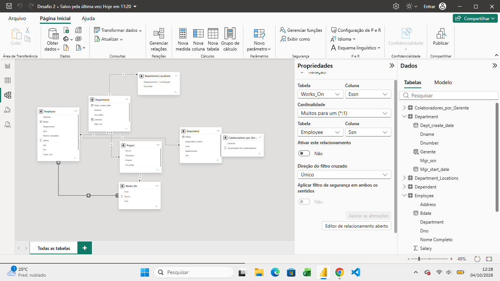

# Desafio Power BI — Integração com MySQL no Azure

## Dashboard Company — Análise Gerencial

Projeto desenvolvido como parte do desafio prático de **Power BI da DIO**, integrando uma base de dados MySQL hospedada no Microsoft Azure ao Power BI.

O projeto contempla a configuração do banco de dados na nuvem, validação no MySQL Workbench, transformação dos dados com Power Query, construção do modelo relacional e desenvolvimento de um dashboard para análise gerencial.

## Dashboard Final

### Principais indicadores

- **Total de funcionários:** 8
- **Folha salarial total:** R$ 281 mil
- Funcionários e folha salarial por departamento
- Projetos por localização
- Horas trabalhadas por projeto
- Funcionários por supervisor

---

## Objetivos do Projeto

O objetivo foi desenvolver uma solução de Business Intelligence contemplando o fluxo completo dos dados:

**Azure Database for MySQL → Power Query → Modelo de Dados → Dashboard Power BI**

Durante o projeto foram trabalhados:

- Provisionamento e configuração do MySQL no Azure.
- Criação e validação da base de dados.
- Integração entre MySQL e Power BI.
- Tratamento e transformação dos dados.
- Análise de tipos, valores nulos e qualidade das informações.
- Mesclagem e agrupamento de consultas.
- Construção e validação dos relacionamentos.
- Desenvolvimento de indicadores e visualizações gerenciais.
- Documentação das decisões técnicas, dificuldades e aprendizados.

---

## Tecnologias Utilizadas

- Microsoft Azure
- Azure Database for MySQL — Flexible Server
- MySQL
- MySQL Workbench
- Microsoft Power BI Desktop
- Power Query
- DAX
- Git
- GitHub

---

## Configuração do Ambiente

Foi utilizada uma instância **Azure Database for MySQL — Flexible Server**, configurada para desenvolvimento e testes.

Principais configurações:

- **MySQL:** 8.4
- **Camada:** Burstable
- **Instância:** Standard_B1ms
- **Armazenamento:** 20 GiB
- **Rede:** acesso controlado por regra de firewall

Por segurança, credenciais, senhas, endereços IP e demais informações sensíveis não são disponibilizados neste repositório.

A conexão e a integridade inicial da base foram validadas utilizando o **MySQL Workbench**.

### Registros validados

| Tabela | Registros |
|---|---:|
| Employee | 8 |
| Dependent | 7 |
| Department | 3 |
| Department_Locations | 5 |
| Project | 6 |
| Works_On | 16 |

---

## Transformação dos Dados

A preparação dos dados foi realizada no **Power Query**, seguindo os requisitos do desafio.

### Qualidade e Tipos de Dados

Foram analisados cabeçalhos, tipos de dados, valores nulos, erros e campos vazios.

A coluna `Salary`, inicialmente configurada como Número Decimal Fixo, foi ajustada para **Número Decimal (Double)**.

### Tratamento de Valores Nulos

Foi identificado um valor `null` em `Employee[Super_ssn]`.

O registro foi preservado porque representa o colaborador localizado no nível superior da hierarquia organizacional, sem supervisor associado.

Também foi verificado que todos os departamentos possuem gerente definido.

### Colaborador e Departamento

A consulta `Employee` foi mesclada com os dados de departamento, permitindo associar cada colaborador ao respectivo departamento.

Também foram combinados nome e sobrenome para criação da coluna:

`Nome Completo`

### Colaborador e Gerente

Para identificar o gerente de cada colaborador foi realizada uma associação utilizando:

`Employee[Super_ssn] → Employee[Ssn]`

Posteriormente, os dados foram agrupados para calcular a quantidade de colaboradores por gerente.

| Gerente | Colaboradores |
|---|---:|
| Franklin Wong | 3 |
| James Borg | 2 |
| Jennifer Wallace | 2 |
| Sem supervisor | 1 |

### Departamento e Localização

Departamento e localização foram combinados na coluna:

`Departamento - Localização`

Foram obtidas combinações como:

- Headquarters - Houston
- Administration - Stafford
- Research - Bellaire
- Research - Houston
- Research - Sugarland

A chave `Dnumber` foi preservada separadamente para manter os relacionamentos do modelo.

### Por que utilizar Mesclagem?

Foi utilizada a operação de **mesclagem** porque era necessário combinar informações relacionadas mantendo a correspondência entre os registros.

Uma operação de acréscimo apenas empilharia registros verticalmente, não realizando a associação necessária entre departamento e localização.

### Limpeza

Foram removidas colunas estruturadas de navegação e campos auxiliares sem utilização no relatório, preservando as chaves necessárias aos relacionamentos.

---

## Modelo de Dados

O modelo final utiliza as tabelas:

- `Employee`
- `Department`
- `Department_Locations`
- `Dependent`
- `Project`
- `Works_On`
- `Colaboradores_por_Gerente`

Os relacionamentos foram configurados predominantemente como **muitos para um (*:1)**, utilizando direção de filtro única.

O relacionamento:

`Works_On[Essn] → Employee[Ssn]`

foi mantido **inativo** para evitar caminhos ambíguos envolvendo `Employee`, `Department`, `Project` e `Works_On`.

---

## Dificuldades e Soluções

### Provisionamento no Azure

A primeira tentativa de criação do servidor MySQL apresentou conflito durante o provisionamento.

A solução foi realizar uma nova configuração do recurso e validar seu funcionamento antes de prosseguir com a conexão.

### Conectividade

Foi necessário configurar corretamente o acesso entre o computador local e o MySQL hospedado no Azure.

A conexão foi inicialmente validada no MySQL Workbench antes da integração com o Power BI.

### Colunas Estruturadas

A importação gerou colunas estruturadas de navegação relacionadas às tabelas do banco.

Essas estruturas foram analisadas antes da remoção para garantir que nenhuma chave necessária ao modelo fosse eliminada.

### Hierarquia de Gerentes

A associação entre funcionário e gerente exigiu relacionar a tabela de funcionários com ela própria por meio de:

`Super_ssn → Ssn`

O valor nulo encontrado em `Super_ssn` foi preservado por representar corretamente o topo da hierarquia.

### Ambiguidade no Modelo

A ativação simultânea de todos os relacionamentos criaria mais de um caminho de propagação de filtros.

Por esse motivo, `Works_On[Essn] → Employee[Ssn]` foi mantido inativo, preservando a consistência do modelo.

---

## Aprendizados

O projeto proporcionou experiência prática em:

- Configuração de banco MySQL em ambiente Azure.
- Integração entre banco de dados em nuvem e Power BI.
- Validação de dados com MySQL Workbench.
- ETL e preparação de dados com Power Query.
- Mesclagem, agrupamento e combinação de colunas.
- Tratamento contextual de valores nulos.
- Modelagem relacional e cardinalidade.
- Identificação e resolução de ambiguidade de relacionamentos.
- Construção de indicadores e visualizações gerenciais.
- Documentação técnica para projetos de dados.

Um dos principais aprendizados foi compreender que a qualidade de uma solução de BI depende não apenas das visualizações, mas também da qualidade dos dados, das decisões de transformação e da estrutura do modelo.

---

## Resultados

O projeto resultou em uma solução integrada entre **Azure, MySQL e Power BI**, permitindo analisar:

- 8 funcionários
- R$ 281 mil de folha salarial
- 3 departamentos
- 6 projetos
- 16 registros de alocação de horas
- Estrutura de supervisão dos colaboradores

As transformações e relacionamentos foram revisados antes da conclusão para garantir que a limpeza das consultas não comprometesse os indicadores apresentados no dashboard.

---

## Conclusão

Este projeto permitiu aplicar, de forma integrada, conceitos de **computação em nuvem, banco de dados relacional, ETL, qualidade de dados, modelagem e Business Intelligence**.

O desafio envolveu todo o ciclo dos dados: armazenamento no MySQL hospedado no Azure, validação no MySQL Workbench, transformação no Power Query, modelagem e apresentação das informações no Power BI.

As dificuldades encontradas durante o desenvolvimento também fizeram parte do aprendizado, especialmente na configuração da infraestrutura, análise de valores nulos, tratamento das consultas e resolução de ambiguidades no modelo.

O resultado final demonstra não apenas a construção de um dashboard, mas o desenvolvimento de uma solução de dados documentada e adequada para composição de portfólio.

